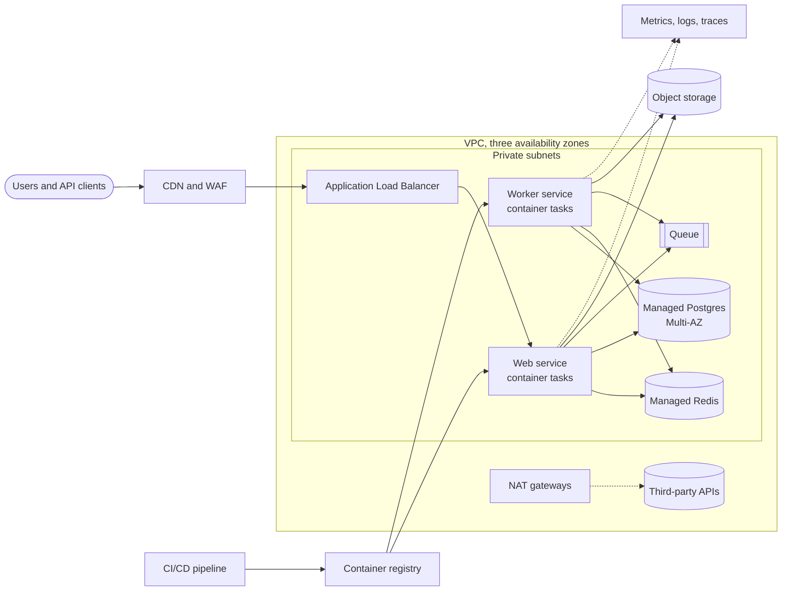

# 2. Target architecture

The reference target for "Acme SaaS": a multi-tenant web application with a Rails-style monolith, background workers, a relational database, a cache and object storage. Adapt the pieces; keep the decision logic.

## 2.1 Diagram

## 2.2 Decisions that matter

Each of these deserves an ADR. Examples are in [adr/](adr/).

| Area | Common options | Default recommendation | Why |
|---|---|---|---|
| Account structure | Single account, per-environment accounts, full landing zone | Separate accounts for production and non-production, managed with AWS Organizations | Limits blast radius and simplifies IAM and billing |
| Compute | ECS on Fargate, ECS on EC2, EKS, plain EC2 | ECS on Fargate for a team new to AWS, EKS only if you already run Kubernetes | Least operational load for a small platform team |
| Database | RDS Postgres, Aurora Postgres, self-managed | RDS Postgres Multi-AZ, move to Aurora when you need its features | Closest to what you run today; fewer surprises |
| Networking | Default VPC, custom VPC | Custom VPC, private subnets for workloads, one NAT per AZ in production | Predictable security and egress control |
| Secrets | Env vars in task definitions, Secrets Manager, Parameter Store | Secrets Manager or Parameter Store injected at start | Rotation and audit trail |
| Deploys | Console, scripts, pipeline | Pipeline with image promotion and automatic rollback | Removes the biggest source of human error |
| Observability | Vendor APM, CloudWatch, both | Keep your current APM during migration so you can compare, add CloudWatch for infrastructure | A like-for-like baseline is how you prove the move worked |
| Edge | Direct to load balancer, CDN and WAF | CDN and WAF in front, origin locked down | Absorbs spikes and blocks obvious abuse |

## 2.3 Non-negotiables before production

- Infrastructure defined in code and reviewed like application code
- Encryption at rest and in transit, with keys under your control where required
- Backups with a tested restore, and point-in-time recovery for the database
- Alarms on error rate, latency, queue depth, database CPU, connections and storage
- A budget and cost anomaly alerts per account
- Least-privilege access through SSO, no long-lived admin keys

## 2.4 Things that surprise teams

- **Egress and NAT costs.** Data leaving AWS, and traffic through NAT gateways, can become a top-five cost line. Use gateway VPC endpoints for S3 and DynamoDB, and check cross-AZ traffic.
- **Connection limits.** Moving from a PaaS connection pooler to a direct database can exhaust connections. Plan a pooler (for example PgBouncer or RDS Proxy) and test under load.
- **Ephemeral filesystems.** Anything the app writes locally must move to object storage.
- **Time zones, locales and OS packages.** Container base images differ from the buildpacks you used before.
- **IP addresses.** Customers who allowlisted your old IPs need notice, and you need static egress addresses on the new side.
